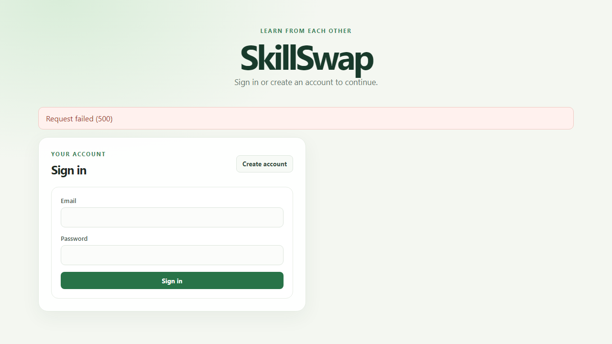

# SkillSwap final deployment report

**Checked:** 2026-11-25  
**Deployment:** [https://2230957-s6-skillswap.vercel.app/](https://2230957-s6-skillswap.vercel.app/)  
**API docs:** [https://2230957-s6-skillswap.vercel.app/api/docs](https://2230957-s6-skillswap.vercel.app/api/docs)  
**OpenAPI:** [https://2230957-s6-skillswap.vercel.app/api/openapi.json](https://2230957-s6-skillswap.vercel.app/api/openapi.json)

## Result

The public Vercel frontend responds, but the deployed API is currently returning HTTP 500. The sign-in page renders an API error during session restoration. As a result, authenticated live acceptance checks, safe demo-data provisioning, and screenshots of authenticated flows could not be completed. No production configuration was changed, no credentials were read or printed, and no demo accounts or records were created.

The public response does not identify the cause of the API failure. Check the Vercel backend deployment and its production environment configuration, including the persistent PostgreSQL `DATABASE_URL`, `JWT_SECRET_KEY`, and `PASSWORD_PEPPER`; do not copy any secret values into this repository.

## Live checks

| Check | Result |
| --- | --- |
| Frontend `GET /` | HTTP 200; sign-in page rendered |
| Browser session restore | API error banner: `Request failed (500)` |
| `GET /api/health` | HTTP 500 |
| `GET /api/docs` | HTTP 500 |
| `GET /api/openapi.json` | HTTP 500 |
| `/#admin` app-shell reload | Frontend shell rendered; admin view could not be authenticated |
| Supabase/PostgreSQL persistence | Not verified; production database access was not available to the provisioning process |
| Signup, login, refresh, logout | Not verified; blocked by the API error |
| CRUD, ownership denials, group capabilities | Not verified; blocked by the API error |
| Admin controls, audit view, CSV exports | Not verified; blocked by the API error |
| Demo users/group | Not provisioned; no writes were attempted |

The screenshot below is a genuine capture of the live deployment. It documents the current failure state; it is not evidence that the authenticated acceptance flows passed.

## Local verification

- Backend API and seed-provisioning test suite: **26 tests passed**.
- Frontend production TypeScript/Vite build: **passed**.
- The frontend API client uses same-origin `/api/...` paths. The only `127.0.0.1` API URL is the Vite development proxy in `frontend/vite.config.ts`.
- Deployment routing is configured in `vercel.json`; live API health/docs responses are not currently successful.
- The demo provisioner defaults to dry-run, accepts PostgreSQL only, requires explicit write confirmation, reuses only accounts with the expected active role, and refuses mismatched existing sample data rather than overwriting it.

## Final live-check checklist

- [ ] Resolve the Vercel API HTTP 500 and confirm `/api/health`, `/api/docs`, and `/api/openapi.json` return successfully.
- [ ] Confirm the Vercel backend is connected to persistent Supabase/PostgreSQL and data survives redeploy/restart.
- [ ] From a trusted operator environment, set the deployment-matching secrets and demo-account environment variables; run `python backend\seed_demo.py` first, inspect the dry run, then use the explicit `--apply` confirmation.
- [ ] Record the resulting account IDs and roles in the README; do not record emails or passwords there.
- [ ] Verify signup/login/refresh/logout, CRUD, cross-owner denials, the mixed-permission group, admin controls, audit activity, and filtered CSV exports against the deployed URL.
- [ ] Capture genuine screenshots of the working user view, admin dashboard, denied action, refresh flow, and activity log; replace/update the blocker-only screenshot and report PDF.
- [ ] The student records and submits their own 5–8 minute narrated video demo using the course form. This repository does not include a substitute recording.
