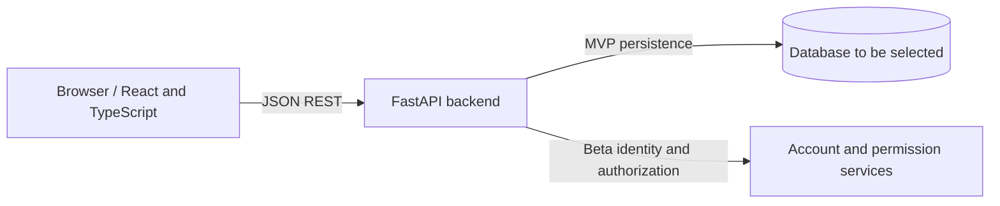
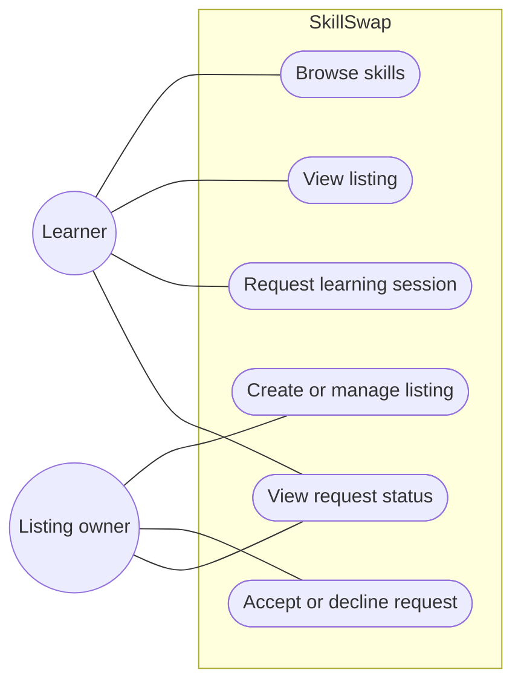
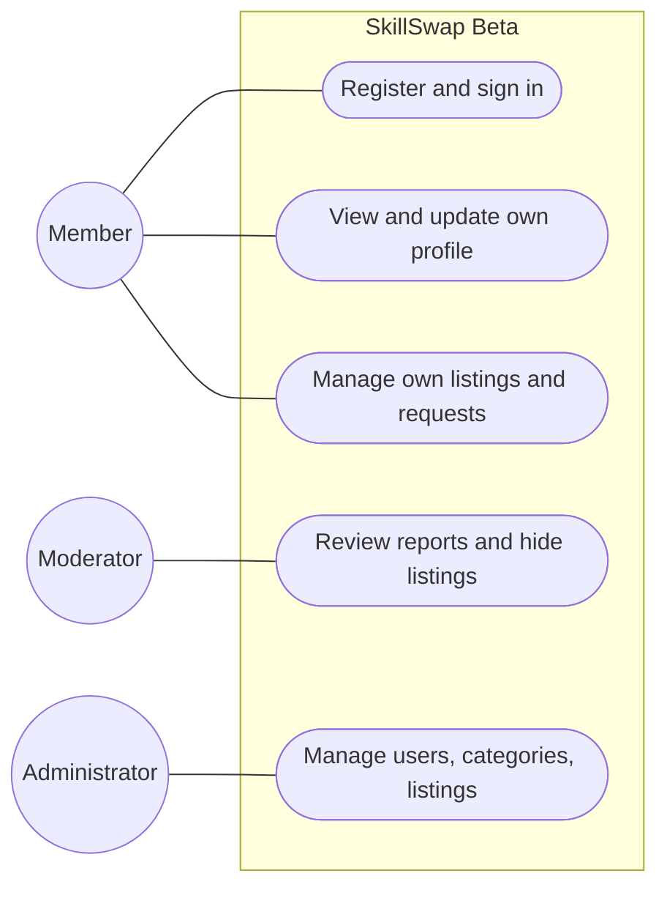
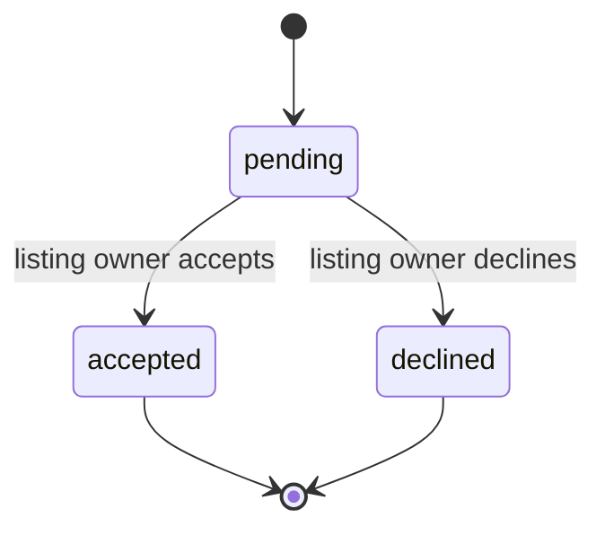

# Software Requirements Specification (SRS) — SkillSwap

| Field | Value |
|---|---|
| Product | SkillSwap |
| Version | MVP + Beta |
| Releases | MVP — Mid-term, Beta — Final |
| Status | Draft |
| Related docs | [Product Requirements Document (PRD)](01-prd.md), [Technical Design Document (TDD)](03-tdd.md) |

Every requirement has a **Release** column or label: **MVP** is built for the mid-term; **Beta** extends it for the final.

**Documents in this set**

| Short form | Full form | Purpose | File |
|---|---|---|---|
| PRD | Product Requirements Document | What we build and why | [01-prd.md](01-prd.md) |
| SRS | Software Requirements Specification | Exact requirements, permissions, and acceptance criteria (this document) | [02-srs.md](02-srs.md) |
| TDD | Technical Design Document | How we build it: architecture, data model, and API | [03-tdd.md](03-tdd.md) |

## 1. Introduction

### 1.1 Purpose

This document specifies SkillSwap's externally observable requirements for the MVP (skill listings and session requests) and Beta (accounts, profiles, roles, scopes, moderation, administration, and deployment).

### 1.2 Scope

- **MVP:** users browse and manage skill listings and use a REST API to request and respond to learning sessions. The application runs locally.
- **Beta:** registered members use profiles and authenticated APIs; member, moderator, and administrator actions are authorized on the backend.
- The system uses a React + TypeScript frontend and FastAPI + Python backend.
- Out of scope: payments, real-time chat/video, mobile applications, and calendar integrations. See [PRD, section 5](01-prd.md#5-scope).

### 1.3 Definitions

| Term | Meaning |
|---|---|
| Skill listing | A member-authored description of a skill they can teach. |
| Session request | A learner's request to arrange a learning session for a skill listing. |
| Listing owner | The member who created a skill listing and can respond to requests for it. |
| CRUD | Create, Read, Update, Delete |
| REST | API style that uses resources and HTTP methods such as GET, POST, PATCH, and DELETE. |
| RBAC | Role-Based Access Control: access is granted according to a user's role. |
| Scope | A permission representing an allowed operation, such as `skills:create`. |
| MVP | Mid-term release focused on the core listing and session-request workflow. |
| Beta | Final release that adds accounts, authorization, profiles, administration, and deployment. |

## 2. Overall description

### 2.1 System context

The repository currently provides a React starter, a FastAPI health/hello API, a Vite proxy, and Vercel configuration. The requirements below describe planned SkillSwap behavior; the listing, request, persistence, and account features are not implemented yet.

### 2.2 Users and roles

| User class / role | Release | Description |
|---|---|---|
| Visitor | MVP | Browses public skill listings and views listing details. |
| Member | MVP/Beta | Can teach and learn, manage own listings, and participate in relevant requests. MVP identity is a demo concern; Beta identity is authenticated. |
| Moderator | Beta | Reviews reports and hides inappropriate listings. |
| Administrator | Beta | Manages users, categories, and listings across the platform. |

### 2.3 Use cases

**MVP**

**Beta**

### 2.4 Constraints

- The frontend shall use React and TypeScript; the backend shall use FastAPI and Python.
- The frontend and backend communicate through JSON REST APIs.
- The database is not yet selected. The design must support local development and persistence across restarts.
- The MVP must be demonstrable locally. Deployment is planned for Beta.
- Authentication is not implemented in the current starter and is a Beta feature.

### 2.5 Assumptions

- A member may be both a teacher and a learner.
- A request initially represents an interest in a listing; time coordination can happen outside the application.
- The listing owner is the teacher for a request created against that listing.
- Production ownership and role checks require authenticated identity and must be enforced by the backend.

## 3. Functional requirements

### 3.1 Skill listings — MVP

| ID | Requirement |
|---|---|
| SRS-F01 | The API shall return available skill listings. |
| SRS-F02 | A client shall be able to retrieve an individual listing by its identifier. |
| SRS-F03 | A member shall be able to create a listing with valid required fields. |
| SRS-F04 | A member shall be able to update or delete only their own listing. |
| SRS-F05 | The API shall validate listing data and reject invalid payloads with an appropriate client-error response. |
| SRS-F06 | A listing that is hidden or unavailable shall not be offered for a new session request. |

### 3.2 Session requests — MVP

| ID | Requirement |
|---|---|
| SRS-F07 | A learner shall be able to create a request for an available listing. |
| SRS-F08 | A request shall identify its listing, learner, listing owner, message/learning goal, status, and timestamps. |
| SRS-F09 | A request shall begin in `pending` status. |
| SRS-F10 | The listing owner shall be able to accept or decline a pending request. |
| SRS-F11 | A participant shall be able to view only requests in which they are involved. |
| SRS-F12 | The API shall reject responses by a caller who is not the listing owner and reject invalid terminal status transitions. |

### 3.3 Authentication and profile — Beta

| ID | Requirement |
|---|---|
| SRS-F13 | A visitor shall be able to register with valid account details. |
| SRS-F14 | A registered member shall be able to authenticate and sign out. |
| SRS-F15 | An authenticated member shall be able to retrieve and update permitted fields in their own profile. |
| SRS-F16 | The backend shall associate each authenticated operation with the identity from verified credentials, not a client-supplied user identifier. |

### 3.4 Roles (RBAC) and administration — Beta

| ID | Requirement |
|---|---|
| SRS-F17 | The backend shall authorize each protected operation according to the caller's role and required scope. |
| SRS-F18 | A member shall manage their own listings and participate in their own session requests. |
| SRS-F19 | A moderator shall review reports and hide inappropriate listings. |
| SRS-F20 | An administrator shall manage users, categories, and listings across the platform. |
| SRS-F21 | The client may hide unavailable controls, but the API shall independently enforce every permission. |

### 3.5 Validation rules

| Data | Rule | Release |
|---|---|---|
| Skill title | Required, non-empty after trimming, and within a documented maximum length. | MVP |
| Skill description | Required and within a documented maximum length. | MVP |
| Category | Must refer to a valid category when categories are enabled. | MVP/Beta |
| Request listing | Must reference an existing available listing. | MVP |
| Request status | Must be one of `pending`, `accepted`, or `declined`; only the listing owner may respond. | MVP |
| Account email | Required and unique; normalize and validate before account creation. | Beta |
| Password | Must satisfy documented minimum policy and be stored only as a password hash. | Beta |

Exact maximum lengths and password policy shall be defined with implementation and tested consistently in the API.

### 3.6 Session-request states

The MVP does not include rescheduling, cancellation, or reopening terminal requests.

### 3.7 Permission matrix — Beta

| Action | Visitor | Member | Moderator | Administrator |
|---|---:|---:|---:|---:|
| Browse public listings | Yes | Yes | Yes | Yes |
| Create listing | No | Yes | Yes, as a member | Yes |
| Update/delete own listing | No | Yes | Yes, as a member | Yes |
| Manage another member's listing | No | No | Hide/review only | Yes |
| Create session request | No | Yes | Yes, as a member | Yes |
| Respond to request as listing owner | No | Own listing only | Own listing only | Per administrative policy |
| Review reports/hide listings | No | No | Yes | Yes |
| Manage users and categories | No | No | No | Yes |

All permissions in this matrix are enforced by the backend in Beta. The MVP does not provide production account authentication.

### 3.8 Status codes

| Status | Meaning | Typical use |
|---|---|---|
| `200 OK` | Request succeeded | Read or update resource |
| `201 Created` | Resource created | Create listing, request, or account |
| `204 No Content` | Operation succeeded without response body | Delete resource |
| `401 Unauthorized` | Authentication missing or invalid | Beta protected endpoint |
| `403 Forbidden` | Caller is authenticated but lacks permission | Ownership, role, or scope failure |
| `404 Not Found` | Resource does not exist or is not visible to caller | Listing/request lookup |
| `409 Conflict` | Operation conflicts with current state | Duplicate account email or invalid state transition |
| `422 Unprocessable Entity` | Input validation failed | Invalid request body |
| `500 Internal Server Error` | Unexpected server failure | Generic response; do not expose stack trace |

## 4. Non-functional requirements

| ID | Requirement | Release |
|---|---|---|
| SRS-NF01 | API inputs shall be validated by the backend independently of browser validation. | MVP |
| SRS-NF02 | API operations shall return documented JSON shapes and appropriate HTTP status codes. | MVP |
| SRS-NF03 | The frontend and backend shall run locally using documented setup commands. | MVP |
| SRS-NF04 | Persistent application data shall survive backend restarts. | MVP |
| SRS-NF05 | Every protected operation shall be authorized by the backend on each request. | Beta |
| SRS-NF06 | Passwords shall be stored as salted hashes using a maintained password-hashing library. | Beta |
| SRS-NF07 | Secrets shall be supplied via environment configuration or a managed secret store, not committed to source control. | Beta |
| SRS-NF08 | Errors shall not reveal passwords, tokens, secret configuration, or internal stack traces. | Beta |
| SRS-NF09 | Production traffic shall use HTTPS and secure credential handling for the selected authentication design. | Beta |
| SRS-NF10 | Automated tests shall cover validation, ownership, request participation, and role/scope authorization. | Beta |

## 5. Acceptance criteria

### MVP

- A visitor can browse available listings and view a listing detail.
- A member can create, update, and delete a listing; an attempt to modify a listing they do not own is rejected by the API's demo ownership strategy.
- A learner can create a request for an available listing.
- The listing owner can accept or decline the pending request; unrelated users cannot respond.
- Both participants can view the correct request status.
- Invalid inputs return client errors, and the frontend displays the API error.
- The application can be started and demonstrated locally.

### Beta

- A user can register, authenticate, sign out, and view/update permitted fields on their own profile.
- A member cannot access or modify another member's protected resources.
- A moderator can review reports and hide listings but cannot perform administrator-only user management.
- An administrator can perform the defined platform management actions.
- Tests verify allowed and denied actions for each role and scope.
- Deployment uses HTTPS and does not expose secrets in the frontend bundle or API responses.

## 6. Traceability

| PRD goal / story | SRS requirements | Verification |
|---|---|---|
| G-1, US-1, US-2 | SRS-F01 to SRS-F02 | Listing API and UI tests |
| G-2, US-3 | SRS-F03 to SRS-F06 | CRUD, validation, and ownership tests |
| G-3, US-4 to US-6 | SRS-F07 to SRS-F12 | Request lifecycle and participant tests |
| G-5, US-7 to US-8 | SRS-F13 to SRS-F16 | Authentication and profile tests |
| G-6, G-7, US-9 to US-11 | SRS-F17 to SRS-F21 | Role/scope permission tests |
| G-8 | SRS-NF07 to SRS-NF10 | Deployment and security checks |
