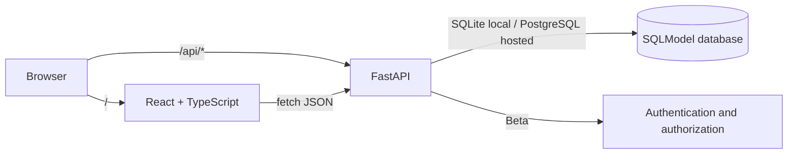
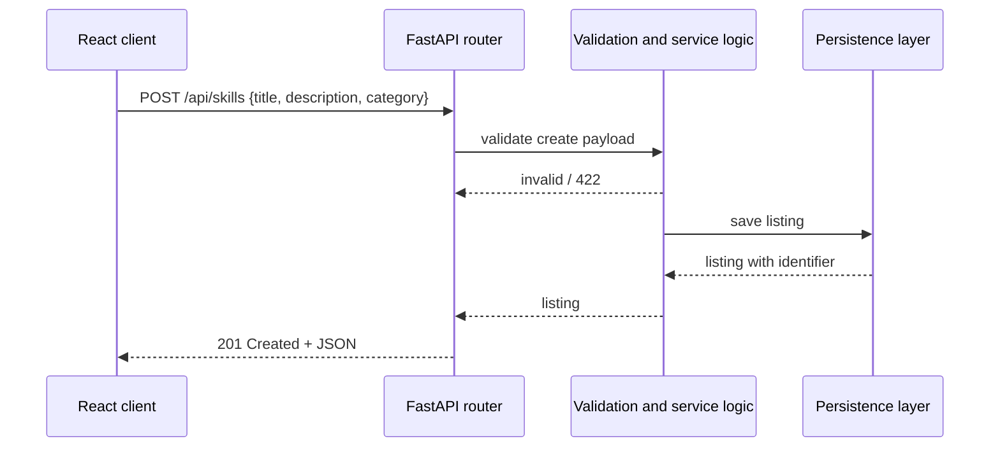
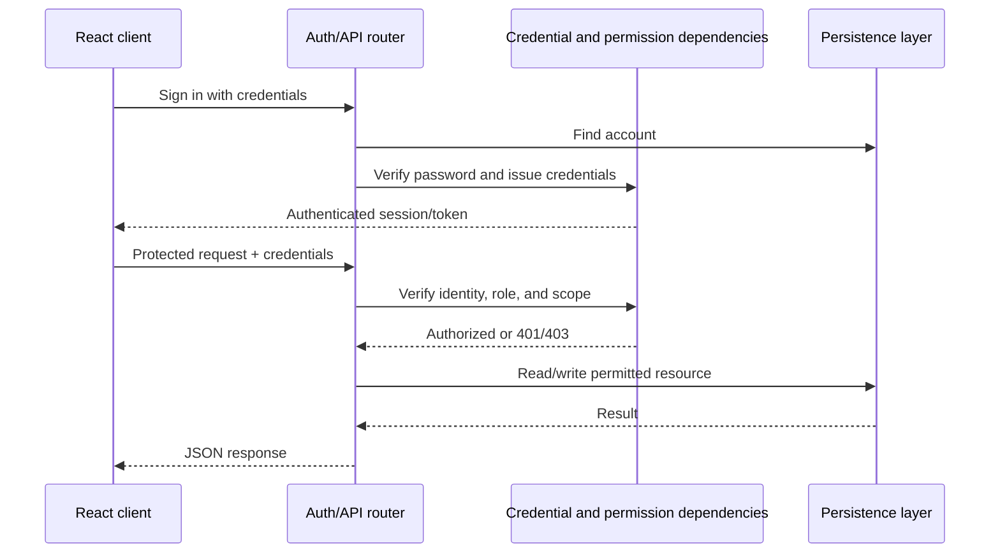

# Technical Design Document (TDD) — SkillSwap

| Field | Value |
|---|---|
| Product | SkillSwap |
| Version | MVP + Beta |
| Releases | MVP — Mid-term, Beta — Final |
| Status | Draft |
| Related docs | [Product Requirements Document (PRD)](01-prd.md), [Software Requirements Specification (SRS)](02-srs.md) |

Sections and tables are marked **MVP** or **Beta**. The current implementation includes CRUD, account authentication, ownership checks, participant authorization, and reusable backend RBAC. Groups and administration remain later Beta work.

**Documents in this set**

| Short form | Full form | Purpose | File |
|---|---|---|---|
| PRD | Product Requirements Document | What we build and why | [01-prd.md](01-prd.md) |
| SRS | Software Requirements Specification | Exact requirements, permissions, and acceptance criteria | [02-srs.md](02-srs.md) |
| TDD | Technical Design Document | How we build it: architecture, data model, and API (this document) | [03-tdd.md](03-tdd.md) |

## 1. Overview

- **MVP:** React + TypeScript and FastAPI + Python implement persistent skill listing and session request CRUD over REST.
- **Beta:** Account authorization, ownership, participant permissions, and role-based dependencies are implemented. Groups, moderation, administration, and final-demo deployment remain.
- **Current status:** The repository includes authenticated CRUD and ownership-aware UI. SQLite is the local database; PostgreSQL is selected through `DATABASE_URL`.

## 2. Tech stack

| Layer | Choice | Why | Release |
|---|---|---|---|
| API | FastAPI | Python REST API with request validation, type hints, and generated OpenAPI docs; already in the repository | MVP |
| Frontend | Vite + React + TypeScript | Required course stack and already in the repository | MVP |
| API format | JSON over REST | Simple interface between the web client and API | MVP |
| Data validation | Pydantic through FastAPI | Validate payloads at the backend boundary | MVP |
| ORM / models | SQLModel | Typed SQL persistence and validation models | MVP |
| Database (local) | SQLite | Zero-configuration local development and persistence across restarts | MVP |
| Database (hosted) | PostgreSQL through `DATABASE_URL` | Supports a hosted database such as Supabase | MVP |
| PostgreSQL driver | Psycopg 3 | SQLModel/SQLAlchemy PostgreSQL connectivity | MVP |
| Persistence layer | SQLModel session dependency | Reuse a request-scoped database session | MVP |
| Hosting | Vercel configuration is present | Existing config describes separate frontend and backend services; verify compatibility before Beta deployment | Beta |
| Password hashing | Argon2id with server-side HMAC pepper | Never store plaintext passwords | Beta |
| Access authentication | HS256 JWT, 15-minute expiry, bearer header | Verify identity on protected API requests | Beta |
| Refresh sessions | Random refresh token, SHA-256 hash in database, rotating httpOnly cookie | Revoke sessions and invalidate access tokens on revocation | Beta |
| Auth dependencies | FastAPI bearer dependency with live user/session lookup | Reject invalid, expired, revoked, or inactive sessions | Beta |
| Authorization dependencies | Reusable permission constants and FastAPI dependency factory | Enforce role permissions before resource ownership checks | Beta |

New SQLModel tables are created at API startup. An idempotent ownership migration adds nullable foreign keys and indexes to existing SQLite and PostgreSQL tables while leaving legacy records unowned.

## 3. Architecture



In local development, Vite proxies `/api` to the FastAPI server, as configured in `frontend/vite.config.ts`. The existing Vercel configuration routes `/api/*` to the backend service and other paths to the frontend service. Keep API paths under `/api`.

The target backend request flow is:

1. Router receives the HTTP request and validates its payload with a Pydantic schema.
2. The authentication dependency validates the JWT and its active refresh-session record and resolves the caller's user from the database.
3. Permission dependencies validate the authenticated role; resource logic then verifies listing ownership or request participation.
4. Persistence boundary reads or writes the records.
5. Router returns a documented response schema and HTTP status.

### 3.1 Request flow — MVP



New listing ownership and request learner identity are derived from the verified user. Legacy records retain null ownership and are excluded from member views.

### 3.2 Authentication and authorization flow — Beta



Access tokens are short-lived JWTs kept only in frontend memory. Refresh tokens are random, hashed in the database, rotated on refresh, and delivered in an httpOnly, SameSite=Lax cookie. Logout, password change, and session revocation invalidate database sessions; each protected API request checks that its session remains active.

## 4. Project structure

The implementation is intentionally small and organized around the current feature set:

```text
backend/
  main.py
  database.py                  # engine, DATABASE_URL, request-scoped sessions
  auth.py                      # user/session tables, JWT, password hashing, auth routes
  authorization.py             # reusable FastAPI permission dependencies
  permissions.py               # role and permission constants
  migrations.py                # idempotent resource-ownership migration
  models.py                    # SQLModel tables and API schemas
  tests/
    test_api.py                # CRUD, auth, validation, cascade, and persistence tests
frontend/
  src/
    api.ts                     # typed REST client
    App.tsx                    # MVP listing and session request workflows
    index.css
docs/
  01-prd.md
  02-srs.md
  03-tdd.md
```

## 5. Data model

### 5.1 Skill listing — MVP

| Field | Type / rule | Notes |
|---|---|---|
| `id` | Stable identifier, primary key | Generated by persistence layer |
| `teacher_name` | Required bounded string | Listing display name |
| `owner_id` | Nullable foreign key to `User` | Set from authenticated identity; null for legacy records |
| `title` | Required bounded string | Trim whitespace and reject empty value |
| `description` | Required bounded text | Validate maximum size |
| `category` | Required bounded string | Category management is planned for Beta |
| `created_at` | Timestamp | Set by backend |

### 5.2 Session request — MVP

| Field | Type / rule | Notes |
|---|---|---|
| `id` | Stable identifier, primary key | Generated by persistence layer |
| `skill_listing_id` | Required foreign key to a listing | Related requests are deleted when their listing is deleted |
| `learner_id` | Nullable foreign key to `User` | Set from authenticated identity; null for legacy records |
| `learner_name` | Required bounded string | Copied from the authenticated user's display name |
| `message` | Required bounded text | Learner's goal or introduction |
| `status` | `pending`, `accepted`, or `declined` | Starts as `pending`; only the listing owner can update it |
| `created_at` | Timestamp | Set by backend |

### 5.3 Full data model — Beta

| Entity | Key data and relationships | Release |
|---|---|---|
| `User` | Unique email, Argon2id password hash, display name, role, active/lockout fields, timestamps | Beta |
| `RefreshSession` | User, hashed refresh token, expiry/revocation/replacement timestamps, device metadata | Beta |
| `Category` | Unique name, description | Beta |
| `SkillListing` | Owner, category, title, description, availability/visibility, timestamps | MVP/Beta |
| `SessionRequest` | Listing and learner foreign keys, display name, message, status, timestamp | MVP/Beta |
| `Report` | Reporter, listing, reason, review state, moderator action, timestamps | Beta |

Use foreign keys and database constraints for required references and unique account email. Consider indexes for listing availability/category and session request participants/status. Decide cascade, archival, and deletion behavior before writing migrations.

### 5.4 Authentication schemas and secrets

- Signup accepts email, display name, and a password of at least 12 characters. Role is assigned by the server and cannot be selected by public signup.
- Login uses a generic invalid-credentials response and applies a temporary account lock after repeated failed attempts.
- Profile and password-change schemas only expose permitted fields. Password changes require the current password and revoke all sessions.
- `JWT_SECRET_KEY` and `PASSWORD_PEPPER` are independent secrets of at least 32 characters. Production must supply stable values through Vercel environment configuration; local development may use temporary generated values.
- Never return password hashes or refresh-token hashes through API response schemas.

### 5.6 Schemas

Keep API schemas separate by operation where fields differ:

- `SkillListingCreate` and `SkillListingUpdate`: validated listing fields.
- `SkillListingRead`: public listing fields and creation timestamp; omit private account data.
- `SessionRequestCreate`: listing identifier, learner name, and request message.
- `SessionRequestUpdate`: explicitly allowed request fields, including status.
- `SessionRequestRead`: request fields and identifier.
- Account/profile schemas must never expose password hashes or credential secrets.

## 6. REST API design

All application routes use the `/api` prefix to match the Vite proxy and Vercel rewrite configuration. Final route names may change with implementation.

### 6.1 Endpoints — MVP

| Method | Path | Purpose | Success |
|---|---|---|---|
| `GET` | `/api/skills` | Browse available listings | `200` |
| `POST` | `/api/skills` | Create a listing | `201` |
| `GET` | `/api/skills/{skill_id}` | Retrieve listing details | `200` |
| `PATCH` | `/api/skills/{skill_id}` | Update an owned listing | `200` |
| `DELETE` | `/api/skills/{skill_id}` | Delete an owned listing | `204` |
| `POST` | `/api/session-requests` | Create a request for an existing listing | `201` |
| `GET` | `/api/session-requests` | List requests involving caller as learner or listing owner | `200` |
| `GET` | `/api/session-requests/{request_id}` | Retrieve a participant request | `200` |
| `PATCH` | `/api/session-requests/{request_id}` | Learner updates message; listing owner updates status | `200` |
| `DELETE` | `/api/session-requests/{request_id}` | Delete a request as a participant | `204` |

Every resource endpoint requires a valid authenticated session and permission dependency. Signed-in members can browse listings with owners; only an owner can modify or delete a listing. Legacy unowned listings are excluded from member views.

### 6.2 Endpoints — Beta

| Method | Path | Purpose | Success |
|---|---|---|---|
| `POST` | `/api/auth/signup` | Register a new member account | `201` |
| `POST` | `/api/auth/login` | Authenticate and issue short-lived JWT plus refresh cookie | `200` |
| `POST` | `/api/auth/refresh` | Rotate refresh session and issue a new JWT | `200` |
| `POST` | `/api/auth/logout` | Revoke the current refresh session | `204` |
| `GET` | `/api/users/me` | Retrieve the authenticated member's profile | `200` |
| `PATCH` | `/api/users/me` | Update permitted profile fields | `200` |
| `POST` | `/api/users/me/password` | Change password and revoke all sessions | `204` |
| `GET` | `/api/users/me/sessions` | List the member's refresh sessions | `200` |
| `DELETE` | `/api/users/me/sessions/{session_id}` | Revoke one of the member's sessions | `204` |
| `GET` | `/api/reports` | Review reports | `200`, moderator/admin |
| `PATCH` | `/api/reports/{report_id}` | Resolve report and optionally hide listing | `200`, moderator/admin |
| `GET` | `/api/admin/users` | List/manage user accounts | `200`, administrator |
| `PATCH` | `/api/admin/users/{user_id}` | Update permitted user status/role | `200`, administrator |
| `GET` | `/api/admin/categories` | Manage categories | `200`, administrator |

Authentication and profile endpoints are implemented. The remaining Beta admin/group endpoints require verified identity and the applicable role/scope; final route set should be limited to what is needed for the demo.

### 6.3 Examples

Create a listing:

```http
POST /api/skills
Content-Type: application/json

{
  "teacher_name": "Ari",
  "title": "Beginner guitar",
  "description": "Learn basic chords and strumming patterns.",
  "category": "Music"
}
```

Create a session request:

```http
POST /api/session-requests
Content-Type: application/json

{
  "skill_listing_id": 12,
  "learner_name": "Jamie",
  "message": "I would like to learn the basic chords."
}
```

Update a session request:

```http
PATCH /api/session-requests/31
Content-Type: application/json

{
  "status": "accepted"
}
```

Examples are illustrative. Identifiers, exact required fields, and response schemas depend on the selected persistence design.

### 6.4 Error format

Use FastAPI validation errors for invalid request data and a consistent JSON shape for application errors:

```json
{
  "detail": "Skill listing not found."
}
```

Expected status codes include `401` for missing/invalid Beta credentials, `403` for a permission failure, `404` for a missing resource, `409` for a conflicting state transition or duplicate account, and `422` for invalid input. Do not return stack traces or secrets.

### 6.5 Design rules

- Validate all client input on the backend.
- Do not add owner, role, or scope fields to MVP payloads; Beta identity and permissions must come from verified credentials.
- Keep response schemas limited to the public MVP fields.
- Verify that session requests reference an existing listing and use an allowed status.
- Use `404` for nonexistent resources and `403` for authenticated callers lacking permission, consistently.

## 7. Database access

SQLModel manages the relational tables. SQLite is the local default, stored at `backend/skillswap.db`. When `DATABASE_URL` is set, the API uses that database; PostgreSQL URLs are handled with Psycopg 3. A request-scoped SQLModel `Session` is yielded through FastAPI dependency injection and closed after each request. At startup, SQLModel creates missing tables. The current schema uses a foreign key with `ON DELETE CASCADE` from session requests to skill listings.

The database URL must be configured in the hosting provider for deployed persistence. SQLite is intended for local use, not ephemeral serverless storage.

## 8. Configuration

The database connection is configured as follows:

- Read deployment-specific configuration from environment variables.
- Validate required settings at startup and fail clearly when production configuration is missing.
- Keep `.env` files containing real secrets out of version control.
- Provide safe local-development defaults only for non-secret configuration.
- `DATABASE_URL` is optional locally and required for hosted persistent data. It must not be committed or exposed to the browser.
- Beta settings may include credential signing secrets, credential lifetimes, and allowed origins.

## 9. Deployment

- **MVP local:** run the frontend with Vite and API with FastAPI. The Vite proxy forwards `/api` to the API; SQLite data persists in the backend directory.
- **Hosted demo:** configure `DATABASE_URL` in the backend service using a PostgreSQL connection string, then deploy through the existing `vercel.json` service setup. Vercel's writable filesystem is not a persistent database.
- Use HTTPS and verify the backend and database together after deployment.

Do not claim the app is deployed until the full frontend, API, and selected database have been verified together.

## 10. Auth and RBAC design — Beta

### 10.1 Credentials

Choose either a short-lived signed access token with an appropriately protected refresh mechanism or a secure server-managed session. Document credential storage, expiration, renewal, logout/revocation, and CSRF considerations before implementation. Do not store long-lived secrets in browser-accessible persistent storage without a reviewed security rationale.

### 10.2 Passwords

- Hash passwords with a maintained password-hashing library and a strong work factor.
- Never log, return, or persist plaintext passwords.
- Return generic authentication failures that do not disclose whether an email is registered.
- Apply basic request throttling or login-attempt protections if feasible for Beta.

### 10.3 Permission dependencies

Enforce authorization centrally through FastAPI dependencies or an equivalent backend mechanism:

| Scope example | Allowed operation | Roles |
|---|---|---|
| `skills:read` | Browse owned listings with their owners | Authenticated member |
| `skills:create` | Create a listing | Member, administrator |
| `skills:update:own` | Update/delete own listing | Member, administrator |
| `requests:create` | Create a session request | Member, administrator |
| `requests:update:participant` | Learner updates message or listing owner updates status | Learner or listing owner |
| `requests:read:participant` | Read requests where caller is learner or listing owner | Participant |
| `requests:delete:participant` | Delete a request as learner or listing owner | Participant |

The `user` and `admin` roles currently use reusable permission constants; the backend also checks resource ownership and participation. Public signup cannot assign roles. Admin role management, moderation permissions, and group access are not included in this layer.

### 10.4 Moderator and administrator operations

- A moderator may review reports and hide a listing; moderation actions should be recorded with actor and timestamp.
- An administrator may manage users, categories, and platform listings.
- Use least privilege and test denied operations as well as successful ones.
- Keep administrative endpoints separate and require explicit administrator authorization.

## 11. Security — Beta

- Enforce authentication, ownership, and roles on every protected API request.
- Validate and bound all user-provided fields.
- Use HTTPS in production and secure credential transport/settings selected in the auth design.
- Keep passwords hashed; keep signing/database secrets out of source control.
- Prevent mass assignment by allowing only explicitly modeled update fields.
- Avoid exposing private profile data or internal exception details.
- Use secure CORS configuration appropriate to the deployed frontend origin.
- Test access as visitor, member, moderator, and administrator, including attempts to access another user's resource.

## 12. Migrations and data lifecycle

The ownership migration is idempotent and uses portable `ALTER TABLE` and `CREATE INDEX IF NOT EXISTS` statements for SQLite and PostgreSQL. New ownership foreign keys use `ON DELETE SET NULL`; existing records remain intact with null identities, and listing deletion continues to cascade to related requests.

## 13. Risks and open decisions

| Risk / decision | Impact | Action |
|---|---|---|
| Hosted database credentials are not configured in source control. | A deployed API without `DATABASE_URL` would use local SQLite and lose data between serverless instances. | Configure the Supabase/PostgreSQL connection as a backend environment variable in Vercel. |
| Legacy rows do not have known owners. | Assigning them to a new account would misattribute existing data. | Keep owner references null and hide them until administrator review. |
| Authentication transport is undecided. | Affects frontend storage and backend security. | Select and document token or secure-session design before Beta auth. |
| Course scope is limited. | Large optional features can prevent a complete demo. | Prioritize listings and the request lifecycle; leave integrations out of scope. |
| Existing Vercel config has not been validated with a database. | Deployment may differ from local behavior. | Verify the complete hosted stack during Beta implementation. |
