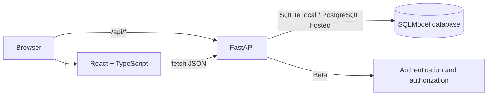
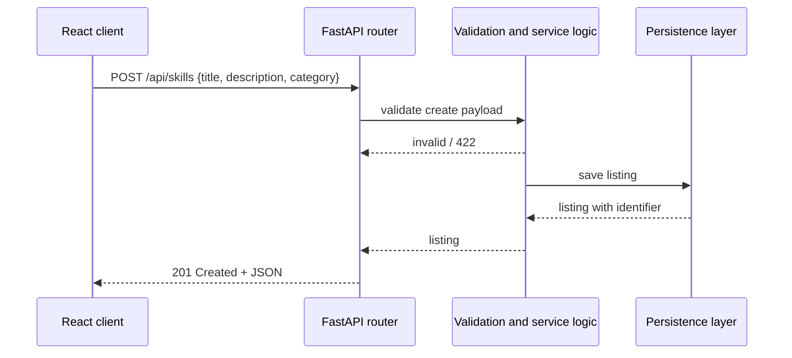
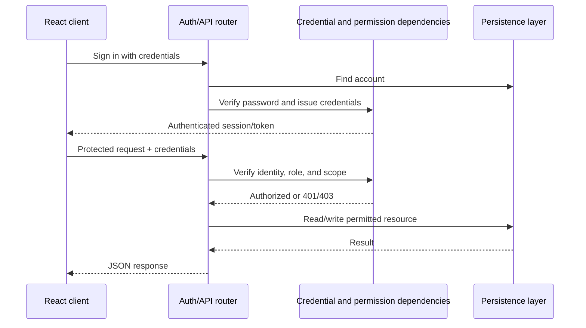

# Technical Design Document (TDD) — SkillSwap

| Field | Value |
|---|---|
| Product | SkillSwap |
| Version | MVP + Beta |
| Releases | MVP — Mid-term, Beta — Final |
| Status | Draft |
| Related docs | [Product Requirements Document (PRD)](01-prd.md), [Software Requirements Specification (SRS)](02-srs.md) |

Sections and tables are marked **MVP** or **Beta**. The MVP implementation below covers skill listing and session request CRUD; Beta extends it with authentication and permissions.

**Documents in this set**

| Short form | Full form | Purpose | File |
|---|---|---|---|
| PRD | Product Requirements Document | What we build and why | [01-prd.md](01-prd.md) |
| SRS | Software Requirements Specification | Exact requirements, permissions, and acceptance criteria | [02-srs.md](02-srs.md) |
| TDD | Technical Design Document | How we build it: architecture, data model, and API (this document) | [03-tdd.md](03-tdd.md) |

## 1. Overview

- **MVP:** React + TypeScript and FastAPI + Python implement persistent skill listing and session request CRUD over REST.
- **Beta:** Add accounts, profiles, member/moderator/administrator roles, backend permission scopes, moderation, administration, and deployment.
- **Current status:** The repository includes MVP CRUD endpoints and UI. SQLite is the local database; PostgreSQL is supported through the `DATABASE_URL` environment variable. Authentication and Beta authorization are not implemented.

## 2. Tech stack

| Layer | Choice | Why | Release |
|---|---|---|---|
| API | FastAPI | Python REST API with request validation, type hints, and generated OpenAPI docs; already in the repository | MVP |
| Frontend | Vite + React + TypeScript | Required course stack and already in the repository | MVP |
| API format | JSON over REST | Simple interface between the web client and API | MVP |
| Data validation | Pydantic through FastAPI | Validate payloads at the backend boundary | MVP |
| ORM / models | SQLModel | Typed SQL persistence and validation models | MVP |
| Database (local) | SQLite | Zero-configuration local development and persistence across restarts | MVP |
| Database (hosted) | PostgreSQL through `DATABASE_URL` | Supports a hosted database such as Supabase | MVP |
| PostgreSQL driver | Psycopg 3 | SQLModel/SQLAlchemy PostgreSQL connectivity | MVP |
| Persistence layer | SQLModel session dependency | Reuse a request-scoped database session | MVP |
| Hosting | Vercel configuration is present | Existing config describes separate frontend and backend services; verify compatibility before Beta deployment | Beta |
| Password hashing | Maintained password-hashing library (choice pending) | Never store plaintext passwords | Beta |
| Authentication | Token or secure-cookie design (choice pending) | Verify identity on protected API requests | Beta |

The MVP creates tables from SQLModel metadata at API startup. A versioned migration framework is deferred until schema evolution requires it.

## 3. Architecture



In local development, Vite proxies `/api` to the FastAPI server, as configured in `frontend/vite.config.ts`. The existing Vercel configuration routes `/api/*` to the backend service and other paths to the frontend service. Keep API paths under `/api`.

The target backend request flow is:

1. Router receives the HTTP request and validates its payload with a Pydantic schema.
2. (Beta) Authentication dependency resolves the caller's identity from verified credentials.
3. Business logic validates resource references and allowed state values. Beta adds ownership, participant, role, and scope checks.
4. Persistence boundary reads or writes the records.
5. Router returns a documented response schema and HTTP status.

### 3.1 Request flow — MVP



The MVP is a shared demonstration with no authentication or ownership checks. Beta must derive ownership and participant identity from verified credentials, never from arbitrary client-supplied identifiers.

### 3.2 Authentication and authorization flow — Beta



The credential transport, token/cookie settings, expiration, and refresh behavior remain an implementation decision. Choose and document them before Beta authentication work.

## 4. Project structure

The implementation is intentionally small and organized around the current feature set:

```text
backend/
  main.py
  database.py                  # engine, DATABASE_URL, request-scoped sessions
  models.py                    # SQLModel tables and API schemas
  tests/
    test_api.py                # CRUD, validation, cascade, and persistence tests
frontend/
  src/
    api.ts                     # typed REST client
    App.tsx                    # MVP listing and session request workflows
    index.css
docs/
  01-prd.md
  02-srs.md
  03-tdd.md
```

## 5. Data model

### 5.1 Skill listing — MVP

| Field | Type / rule | Notes |
|---|---|---|
| `id` | Stable identifier, primary key | Generated by persistence layer |
| `teacher_name` | Required bounded string | Display name entered for the shared MVP demonstration |
| `title` | Required bounded string | Trim whitespace and reject empty value |
| `description` | Required bounded text | Validate maximum size |
| `category` | Required bounded string | Category management is planned for Beta |
| `created_at` | Timestamp | Set by backend |

### 5.2 Session request — MVP

| Field | Type / rule | Notes |
|---|---|---|
| `id` | Stable identifier, primary key | Generated by persistence layer |
| `skill_listing_id` | Required foreign key to a listing | Related requests are deleted when their listing is deleted |
| `learner_name` | Required bounded string | Display name entered for the shared MVP demonstration |
| `message` | Required bounded text | Learner's goal or introduction |
| `status` | `pending`, `accepted`, or `declined` | Starts as `pending`; editable in the shared MVP demo |
| `created_at` | Timestamp | Set by backend |

### 5.3 Full data model — Beta

| Entity | Key data and relationships | Release |
|---|---|---|
| `User` | Unique email, password hash, display name, role, profile data, timestamps | Beta |
| `Category` | Unique name, description | Beta |
| `SkillListing` | Owner, category, title, description, availability/visibility, timestamps | MVP/Beta |
| `SessionRequest` | Skill listing foreign key, learner name, message, status, created timestamp | MVP |
| `SessionRequest` | Listing, learner, teacher/listing owner, message, status, timestamps | Beta identity fields |
| `Report` | Reporter, listing, reason, review state, moderator action, timestamps | Beta |

Use foreign keys and database constraints for required references and unique account email. Consider indexes for listing availability/category and session request participants/status. Decide cascade, archival, and deletion behavior before writing migrations.

### 5.4 Schemas

Keep API schemas separate by operation where fields differ:

- `SkillListingCreate` and `SkillListingUpdate`: validated listing fields.
- `SkillListingRead`: public listing fields and creation timestamp; omit private account data.
- `SessionRequestCreate`: listing identifier, learner name, and request message.
- `SessionRequestUpdate`: explicitly allowed request fields, including status.
- `SessionRequestRead`: request fields and identifier.
- Beta account/profile schemas must never expose password hashes or credential secrets.

## 6. REST API design

All application routes use the `/api` prefix to match the Vite proxy and Vercel rewrite configuration. Final route names may change with implementation.

### 6.1 Endpoints — MVP

| Method | Path | Purpose | Success |
|---|---|---|---|
| `GET` | `/api/skills` | Browse available listings | `200` |
| `POST` | `/api/skills` | Create a listing | `201` |
| `GET` | `/api/skills/{skill_id}` | Retrieve listing details | `200` |
| `PATCH` | `/api/skills/{skill_id}` | Update an owned listing | `200` |
| `DELETE` | `/api/skills/{skill_id}` | Delete an owned listing | `204` |
| `POST` | `/api/session-requests` | Create a request for an existing listing | `201` |
| `GET` | `/api/session-requests` | List shared MVP requests | `200` |
| `GET` | `/api/session-requests/{request_id}` | Retrieve request details | `200` |
| `PATCH` | `/api/session-requests/{request_id}` | Update request fields or status | `200` |
| `DELETE` | `/api/session-requests/{request_id}` | Delete a request | `204` |

The MVP has no authentication; both resource collections are shared demonstration data. Do not treat the MVP as providing owner-only access.

### 6.2 Endpoints — Beta

| Method | Path | Purpose | Success |
|---|---|---|---|
| `POST` | `/api/auth/register` | Register a new account | `201` |
| `POST` | `/api/auth/token` | Authenticate and establish credentials | `200` |
| `POST` | `/api/auth/logout` | Sign out/invalidate credentials, per selected design | `204` |
| `GET` | `/api/users/me` | Retrieve the authenticated member's profile | `200` |
| `PATCH` | `/api/users/me` | Update permitted profile fields | `200` |
| `GET` | `/api/reports` | Review reports | `200`, moderator/admin |
| `PATCH` | `/api/reports/{report_id}` | Resolve report and optionally hide listing | `200`, moderator/admin |
| `GET` | `/api/admin/users` | List/manage user accounts | `200`, administrator |
| `PATCH` | `/api/admin/users/{user_id}` | Update permitted user status/role | `200`, administrator |
| `GET` | `/api/admin/categories` | Manage categories | `200`, administrator |

Beta endpoints require verified authentication and the applicable role/scope. Final route set should be limited to what is needed for the demo.

### 6.3 Examples

Create a listing:

```http
POST /api/skills
Content-Type: application/json

{
  "teacher_name": "Ari",
  "title": "Beginner guitar",
  "description": "Learn basic chords and strumming patterns.",
  "category": "Music"
}
```

Create a session request:

```http
POST /api/session-requests
Content-Type: application/json

{
  "skill_listing_id": 12,
  "learner_name": "Jamie",
  "message": "I would like to learn the basic chords."
}
```

Update a session request:

```http
PATCH /api/session-requests/31
Content-Type: application/json

{
  "status": "accepted"
}
```

Examples are illustrative. Identifiers, exact required fields, and response schemas depend on the selected persistence design.

### 6.4 Error format

Use FastAPI validation errors for invalid request data and a consistent JSON shape for application errors:

```json
{
  "detail": "Skill listing not found."
}
```

Expected status codes include `401` for missing/invalid Beta credentials, `403` for a permission failure, `404` for a missing resource, `409` for a conflicting state transition or duplicate account, and `422` for invalid input. Do not return stack traces or secrets.

### 6.5 Design rules

- Validate all client input on the backend.
- Do not add owner, role, or scope fields to MVP payloads; Beta identity and permissions must come from verified credentials.
- Keep response schemas limited to the public MVP fields.
- Verify that session requests reference an existing listing and use an allowed status.
- Use `404` for nonexistent resources and `403` for authenticated callers lacking permission, consistently.

## 7. Database access

SQLModel manages the relational tables. SQLite is the local default, stored at `backend/skillswap.db`. When `DATABASE_URL` is set, the API uses that database; PostgreSQL URLs are handled with Psycopg 3. A request-scoped SQLModel `Session` is yielded through FastAPI dependency injection and closed after each request. At startup, SQLModel creates missing tables. The current schema uses a foreign key with `ON DELETE CASCADE` from session requests to skill listings.

The database URL must be configured in the hosting provider for deployed persistence. SQLite is intended for local use, not ephemeral serverless storage.

## 8. Configuration

The database connection is configured as follows:

- Read deployment-specific configuration from environment variables.
- Validate required settings at startup and fail clearly when production configuration is missing.
- Keep `.env` files containing real secrets out of version control.
- Provide safe local-development defaults only for non-secret configuration.
- `DATABASE_URL` is optional locally and required for hosted persistent data. It must not be committed or exposed to the browser.
- Beta settings may include credential signing secrets, credential lifetimes, and allowed origins.

## 9. Deployment

- **MVP local:** run the frontend with Vite and API with FastAPI. The Vite proxy forwards `/api` to the API; SQLite data persists in the backend directory.
- **Hosted demo:** configure `DATABASE_URL` in the backend service using a PostgreSQL connection string, then deploy through the existing `vercel.json` service setup. Vercel's writable filesystem is not a persistent database.
- Use HTTPS and verify the backend and database together after deployment.

Do not claim the app is deployed until the full frontend, API, and selected database have been verified together.

## 10. Auth and RBAC design — Beta

### 10.1 Credentials

Choose either a short-lived signed access token with an appropriately protected refresh mechanism or a secure server-managed session. Document credential storage, expiration, renewal, logout/revocation, and CSRF considerations before implementation. Do not store long-lived secrets in browser-accessible persistent storage without a reviewed security rationale.

### 10.2 Passwords

- Hash passwords with a maintained password-hashing library and a strong work factor.
- Never log, return, or persist plaintext passwords.
- Return generic authentication failures that do not disclose whether an email is registered.
- Apply basic request throttling or login-attempt protections if feasible for Beta.

### 10.3 Permission dependencies

Enforce authorization centrally through FastAPI dependencies or an equivalent backend mechanism:

| Scope example | Allowed operation | Roles |
|---|---|---|
| `skills:read` | Browse public listings | Public |
| `skills:create` | Create a listing | Member, moderator, administrator |
| `skills:update:own` | Update/delete own listing | Member, moderator, administrator |
| `requests:create` | Create a session request | Member, moderator, administrator |
| `requests:respond` | Respond to a request for own listing | Listing owner |
| `reports:review` | Review reports and hide listings | Moderator, administrator |
| `users:manage` | Manage user accounts | Administrator |

Scope names and role-to-scope mapping are examples. The backend must also check resource ownership and participation; a scope alone is not sufficient.

### 10.4 Moderator and administrator operations

- A moderator may review reports and hide a listing; moderation actions should be recorded with actor and timestamp.
- An administrator may manage users, categories, and platform listings.
- Use least privilege and test denied operations as well as successful ones.
- Keep administrative endpoints separate and require explicit administrator authorization.

## 11. Security — Beta

- Enforce authentication, ownership, and roles on every protected API request.
- Validate and bound all user-provided fields.
- Use HTTPS in production and secure credential transport/settings selected in the auth design.
- Keep passwords hashed; keep signing/database secrets out of source control.
- Prevent mass assignment by allowing only explicitly modeled update fields.
- Avoid exposing private profile data or internal exception details.
- Use secure CORS configuration appropriate to the deployed frontend origin.
- Test access as visitor, member, moderator, and administrator, including attempts to access another user's resource.

## 12. Migrations and data lifecycle

The migration tool is not selected. Choose one when selecting the database and persistence library. Version schema changes, review upgrade behavior, and keep local setup reproducible. Define deletion/archival behavior for users, listings, requests, and reports before production deployment.

## 13. Risks and open decisions

| Risk / decision | Impact | Action |
|---|---|---|
| Hosted database credentials are not configured in source control. | A deployed API without `DATABASE_URL` would use local SQLite and lose data between serverless instances. | Configure the Supabase/PostgreSQL connection as a backend environment variable in Vercel. |
| MVP has no real authentication. | Shared CRUD data is not owner-private. | Keep the MVP explicit as a shared demo and add verified identity in Beta. |
| Authentication transport is undecided. | Affects frontend storage and backend security. | Select and document token or secure-session design before Beta auth. |
| Course scope is limited. | Large optional features can prevent a complete demo. | Prioritize listings and the request lifecycle; leave integrations out of scope. |
| Existing Vercel config has not been validated with a database. | Deployment may differ from local behavior. | Verify the complete hosted stack during Beta implementation. |
