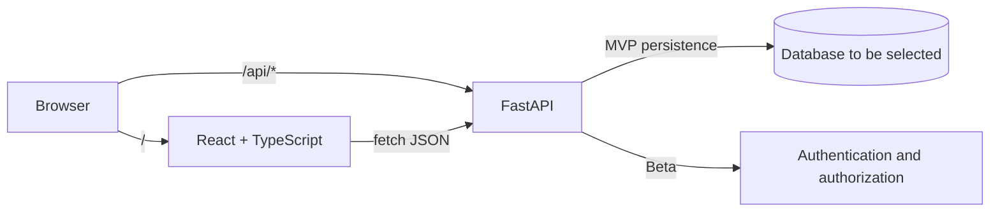
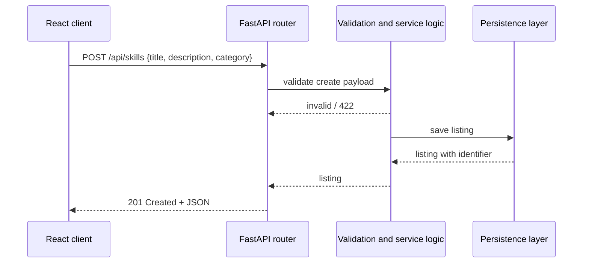
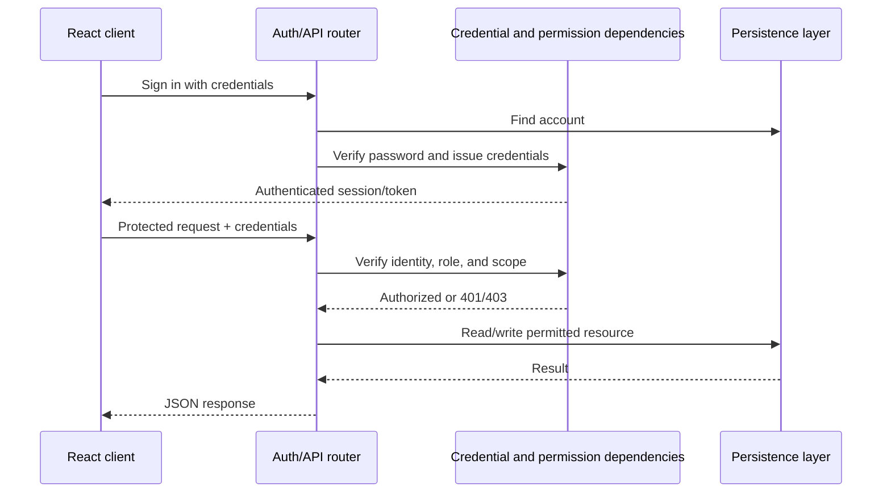

# Technical Design Document (TDD) — SkillSwap

| Field | Value |
|---|---|
| Product | SkillSwap |
| Version | MVP + Beta |
| Releases | MVP — Mid-term, Beta — Final |
| Status | Draft |
| Related docs | [Product Requirements Document (PRD)](01-prd.md), [Software Requirements Specification (SRS)](02-srs.md) |

Sections and tables are marked **MVP** or **Beta**. Build the MVP for the mid-term; Beta extends it for the final. Design choices marked as open must be confirmed before implementation rather than assumed to exist.

**Documents in this set**

| Short form | Full form | Purpose | File |
|---|---|---|---|
| PRD | Product Requirements Document | What we build and why | [01-prd.md](01-prd.md) |
| SRS | Software Requirements Specification | Exact requirements, permissions, and acceptance criteria | [02-srs.md](02-srs.md) |
| TDD | Technical Design Document | How we build it: architecture, data model, and API (this document) | [03-tdd.md](03-tdd.md) |

## 1. Overview

- **MVP:** Extend the existing React + TypeScript and FastAPI + Python starter into a local peer-learning application with persistent skill listings and session request workflows over REST.
- **Beta:** Add accounts, profiles, member/moderator/administrator roles, backend permission scopes, moderation, administration, and deployment.
- **Current status:** The repository currently has a hello/health FastAPI API, a frontend hello form, a Vite API proxy, and Vercel configuration. SkillSwap features and persistence are not yet implemented.

## 2. Tech stack

| Layer | Choice | Why | Release |
|---|---|---|---|
| API | FastAPI | Python REST API with request validation, type hints, and generated OpenAPI docs; already in the repository | MVP |
| Frontend | Vite + React + TypeScript | Required course stack and already in the repository | MVP |
| API format | JSON over REST | Simple interface between the web client and API | MVP |
| Data validation | Pydantic through FastAPI | Validate payloads at the backend boundary | MVP |
| Database | To be selected | Must support local development and persistent listings/requests; decide before implementing storage | MVP |
| Persistence layer | To be selected with database | Keep database access behind a small repository/session boundary | MVP |
| Hosting | Vercel configuration is present | Existing config describes separate frontend and backend services; verify compatibility before Beta deployment | Beta |
| Password hashing | Maintained password-hashing library (choice pending) | Never store plaintext passwords | Beta |
| Authentication | Token or secure-cookie design (choice pending) | Verify identity on protected API requests | Beta |

Do not add a database, ORM, migration framework, or authentication library until the corresponding implementation decision is made and dependencies are reviewed.

## 3. Architecture



In local development, Vite proxies `/api` to the FastAPI server, as configured in `frontend/vite.config.ts`. The existing Vercel configuration routes `/api/*` to the backend service and other paths to the frontend service. Keep API paths under `/api`.

The target backend request flow is:

1. Router receives the HTTP request and validates its payload with a Pydantic schema.
2. (Beta) Authentication dependency resolves the caller's identity from verified credentials.
3. Authorization/business logic checks listing ownership, request participation, role, scope, and state transition.
4. Persistence boundary reads or writes the records.
5. Router returns a documented response schema and HTTP status.

### 3.1 Request flow — MVP



For MVP ownership-sensitive operations, use a controlled local/demo identity strategy. Do not accept arbitrary client-supplied owner IDs and describe them as secure authentication. Replace the demo identity boundary with verified account identity in Beta.

### 3.2 Authentication and authorization flow — Beta



The credential transport, token/cookie settings, expiration, and refresh behavior remain an implementation decision. Choose and document them before Beta authentication work.

## 4. Project structure

The current repository is a small starter with `backend/main.py` and `frontend/src/App.tsx`. Introduce modules incrementally as features are implemented; the following is a proposed target, not the current file tree:

```text
backend/
  main.py
  app/
    config.py                  # environment-backed settings
    routers/
      skills.py                # MVP listing endpoints
      session_requests.py      # MVP request workflow
      auth.py                  # Beta account endpoints
      users.py                 # Beta profile and admin endpoints
    schemas/                   # Pydantic request/response models
    services/                  # business rules and state transitions
    models/                    # persisted entities
    db/                        # database session and persistence setup
frontend/
  src/
    api/                       # typed API calls
    components/                # reusable forms and listing components
    pages/                     # listing, requests, and Beta profile screens
docs/
  01-prd.md
  02-srs.md
  03-tdd.md
```

## 5. Data model

### 5.1 Skill listing — MVP

| Field | Type / rule | Notes |
|---|---|---|
| `id` | Stable identifier, primary key | Generated by persistence layer |
| `owner_id` | Required owner reference or controlled demo identity | Must not be treated as authenticated identity in MVP |
| `title` | Required bounded string | Trim whitespace and reject empty value |
| `description` | Required bounded text | Validate maximum size |
| `category_id` | Category reference, if categories are part of the selected MVP scope | Category management is planned for Beta |
| `is_available` | Boolean/status | Unavailable listings cannot receive new requests |
| `created_at` | Timestamp | Set by backend |
| `updated_at` | Timestamp | Updated by backend |

### 5.2 Session request — MVP

| Field | Type / rule | Notes |
|---|---|---|
| `id` | Stable identifier, primary key | Generated by persistence layer |
| `listing_id` | Required listing reference | Listing must exist and be available |
| `learner_id` | Required participant identity | Derived from controlled MVP demo identity; authenticated in Beta |
| `teacher_id` | Listing owner's identity | Derived from the referenced listing, not trusted from request body |
| `message` | Optional or required bounded text | Final requirement to be decided during implementation |
| `status` | `pending`, `accepted`, or `declined` | Starts as `pending`; owner responds |
| `created_at`, `updated_at` | Timestamps | Set by backend |

### 5.3 Full data model — Beta

| Entity | Key data and relationships | Release |
|---|---|---|
| `User` | Unique email, password hash, display name, role, profile data, timestamps | Beta |
| `Category` | Unique name, description | Beta |
| `SkillListing` | Owner, category, title, description, availability/visibility, timestamps | MVP/Beta |
| `SessionRequest` | Listing, learner, teacher/listing owner, message, status, timestamps | MVP/Beta |
| `Report` | Reporter, listing, reason, review state, moderator action, timestamps | Beta |

Use foreign keys and database constraints for required references and unique account email. Consider indexes for listing availability/category and session request participants/status. Decide cascade, archival, and deletion behavior before writing migrations.

### 5.4 Schemas

Keep API schemas separate by operation where fields differ:

- `SkillCreate` and `SkillUpdate`: accepted listing fields; do not accept arbitrary owner or moderation fields from the client.
- `SkillRead`: public listing fields and appropriate timestamps; omit private account data.
- `SessionRequestCreate`: listing identifier and request message/learning goal; derive teacher from listing.
- `SessionRequestResponse`: only the permitted response status; enforce who may submit it in backend logic.
- `SessionRequestRead`: participant-safe request details.
- Beta account/profile schemas must never expose password hashes or credential secrets.

## 6. REST API design

All application routes use the `/api` prefix to match the Vite proxy and Vercel rewrite configuration. Final route names may change with implementation.

### 6.1 Endpoints — MVP

| Method | Path | Purpose | Success |
|---|---|---|---|
| `GET` | `/api/skills` | Browse available listings | `200` |
| `POST` | `/api/skills` | Create a listing | `201` |
| `GET` | `/api/skills/{skill_id}` | Retrieve listing details | `200` |
| `PATCH` | `/api/skills/{skill_id}` | Update an owned listing | `200` |
| `DELETE` | `/api/skills/{skill_id}` | Delete an owned listing | `204` |
| `POST` | `/api/session-requests` | Create a request for an available listing | `201` |
| `GET` | `/api/session-requests` | List requests relevant to the caller | `200` |
| `PATCH` | `/api/session-requests/{request_id}` | Accept or decline a pending request | `200` |

The request-list endpoint must scope results to relevant participants. Since the MVP has no production authentication, its demo identity mechanism is an explicit limitation and must not be treated as a production access control.

### 6.2 Endpoints — Beta

| Method | Path | Purpose | Success |
|---|---|---|---|
| `POST` | `/api/auth/register` | Register a new account | `201` |
| `POST` | `/api/auth/token` | Authenticate and establish credentials | `200` |
| `POST` | `/api/auth/logout` | Sign out/invalidate credentials, per selected design | `204` |
| `GET` | `/api/users/me` | Retrieve the authenticated member's profile | `200` |
| `PATCH` | `/api/users/me` | Update permitted profile fields | `200` |
| `GET` | `/api/reports` | Review reports | `200`, moderator/admin |
| `PATCH` | `/api/reports/{report_id}` | Resolve report and optionally hide listing | `200`, moderator/admin |
| `GET` | `/api/admin/users` | List/manage user accounts | `200`, administrator |
| `PATCH` | `/api/admin/users/{user_id}` | Update permitted user status/role | `200`, administrator |
| `GET` | `/api/admin/categories` | Manage categories | `200`, administrator |

Beta endpoints require verified authentication and the applicable role/scope. Final route set should be limited to what is needed for the demo.

### 6.3 Examples

Create a listing:

```http
POST /api/skills
Content-Type: application/json

{
  "title": "Beginner guitar",
  "description": "Learn basic chords and strumming patterns."
}
```

Create a session request:

```http
POST /api/session-requests
Content-Type: application/json

{
  "listing_id": 12,
  "message": "I would like to learn the basic chords."
}
```

Respond to a pending request:

```http
PATCH /api/session-requests/31
Content-Type: application/json

{
  "status": "accepted"
}
```

Examples are illustrative. Identifiers, exact required fields, and response schemas depend on the selected persistence design.

### 6.4 Error format

Use FastAPI validation errors for invalid request data and a consistent JSON shape for application errors:

```json
{
  "detail": "The session request is no longer pending."
}
```

Expected status codes include `401` for missing/invalid Beta credentials, `403` for a permission failure, `404` for a missing resource, `409` for a conflicting state transition or duplicate account, and `422` for invalid input. Do not return stack traces or secrets.

### 6.5 Design rules

- Validate all client input on the backend.
- Do not trust client-submitted owner, learner, teacher, role, or scope values; derive them from server-side identity and resource relationships.
- Return only fields appropriate to the caller.
- Enforce request-state transitions and listing availability in backend business logic.
- Use `404` for nonexistent resources and `403` for authenticated callers lacking permission, consistently.

## 7. Database access

Database engine, ORM, and migration tool are open decisions. Before implementation:

1. Select a relational database that can be used locally and hosted for Beta.
2. Select a persistence library compatible with FastAPI and the project scope.
3. Define a repeatable schema creation/migration workflow.
4. Use a per-request database session and ensure it is closed reliably.
5. Keep commits/transactions in service or persistence boundaries, not scattered through UI-facing route code.

MVP data must persist across API restarts to support a complete listing and request workflow.

## 8. Configuration

The existing starter does not yet define database or authentication settings. As those features are added:

- Read deployment-specific configuration from environment variables.
- Validate required settings at startup and fail clearly when production configuration is missing.
- Keep `.env` files containing real secrets out of version control.
- Provide safe local-development defaults only for non-secret configuration.
- Beta settings may include database connection URL, credential signing secret, credential lifetimes, and allowed origins, depending on the final implementation.

## 9. Deployment

- **MVP:** run the frontend with Vite and the API with FastAPI locally. The Vite proxy forwards `/api` to the API.
- **Beta:** verify the existing `vercel.json` frontend/backend service setup, configure the chosen database and secrets in the host, enable HTTPS, and perform a deployment smoke test.

Do not claim the app is deployed until the full frontend, API, and selected database have been verified together.

## 10. Auth and RBAC design — Beta

### 10.1 Credentials

Choose either a short-lived signed access token with an appropriately protected refresh mechanism or a secure server-managed session. Document credential storage, expiration, renewal, logout/revocation, and CSRF considerations before implementation. Do not store long-lived secrets in browser-accessible persistent storage without a reviewed security rationale.

### 10.2 Passwords

- Hash passwords with a maintained password-hashing library and a strong work factor.
- Never log, return, or persist plaintext passwords.
- Return generic authentication failures that do not disclose whether an email is registered.
- Apply basic request throttling or login-attempt protections if feasible for Beta.

### 10.3 Permission dependencies

Enforce authorization centrally through FastAPI dependencies or an equivalent backend mechanism:

| Scope example | Allowed operation | Roles |
|---|---|---|
| `skills:read` | Browse public listings | Public |
| `skills:create` | Create a listing | Member, moderator, administrator |
| `skills:update:own` | Update/delete own listing | Member, moderator, administrator |
| `requests:create` | Create a session request | Member, moderator, administrator |
| `requests:respond` | Respond to a request for own listing | Listing owner |
| `reports:review` | Review reports and hide listings | Moderator, administrator |
| `users:manage` | Manage user accounts | Administrator |

Scope names and role-to-scope mapping are examples. The backend must also check resource ownership and participation; a scope alone is not sufficient.

### 10.4 Moderator and administrator operations

- A moderator may review reports and hide a listing; moderation actions should be recorded with actor and timestamp.
- An administrator may manage users, categories, and platform listings.
- Use least privilege and test denied operations as well as successful ones.
- Keep administrative endpoints separate and require explicit administrator authorization.

## 11. Security — Beta

- Enforce authentication, ownership, and roles on every protected API request.
- Validate and bound all user-provided fields.
- Use HTTPS in production and secure credential transport/settings selected in the auth design.
- Keep passwords hashed; keep signing/database secrets out of source control.
- Prevent mass assignment by allowing only explicitly modeled update fields.
- Avoid exposing private profile data or internal exception details.
- Use secure CORS configuration appropriate to the deployed frontend origin.
- Test access as visitor, member, moderator, and administrator, including attempts to access another user's resource.

## 12. Migrations and data lifecycle

The migration tool is not selected. Choose one when selecting the database and persistence library. Version schema changes, review upgrade behavior, and keep local setup reproducible. Define deletion/archival behavior for users, listings, requests, and reports before production deployment.

## 13. Risks and open decisions

| Risk / decision | Impact | Action |
|---|---|---|
| Database and ORM are undecided. | Blocks reliable persistent CRUD and deployment. | Choose local and hosting-compatible options before implementing storage. |
| MVP has no real authentication. | Ownership-based features cannot be production-secure. | Limit the demo identity approach and replace it with verified identity in Beta. |
| Authentication transport is undecided. | Affects frontend storage and backend security. | Select and document token or secure-session design before Beta auth. |
| Course scope is limited. | Large optional features can prevent a complete demo. | Prioritize listings and the request lifecycle; leave integrations out of scope. |
| Existing Vercel config has not been validated with a database. | Deployment may differ from local behavior. | Verify the complete hosted stack during Beta implementation. |
