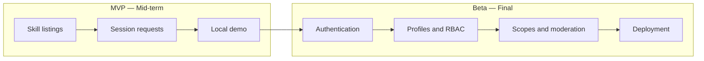

# Product Requirements Document (PRD) — SkillSwap

| Field | Value |
|---|---|
| Product | SkillSwap |
| Version | MVP + Beta |
| Releases | MVP — Mid-term, Beta — Final |
| Status | Draft |
| Related docs | [Software Requirements Specification (SRS)](SRS.md), [Technical Design Document (TDD)](TDD.md) |

This document covers **both releases**. Every goal, feature, and user story has a **Release** column so it is clear what is planned for the mid-term and what is added for the final.

**Documents in this set**

| Short form | Full form | Purpose | File |
|---|---|---|---|
| PRD | Product Requirements Document | What we build and why (this document) | [PRD.md](PRD.md) |
| SRS | Software Requirements Specification | Exact requirements, permissions, and acceptance criteria | [SRS.md](SRS.md) |
| TDD | Technical Design Document | How we build it: architecture, data model, and API | [TDD.md](TDD.md) |

## 0. Release plan

| Release | When | Focus |
|---|---|---|
| **MVP** | Mid-term | Local peer-learning product: skill listing CRUD and session request workflow through REST APIs |
| **Beta** | Final | Accounts, profiles, roles and scopes, moderation, administration, and deployment |

## 1. Purpose

SkillSwap is a peer-to-peer learning platform. Members can share skills they teach, discover skills they want to learn, and arrange learning sessions.

The project is delivered in two focused releases:

1. **MVP (mid-term):** a usable local application for browsing and managing skill listings and sending/responding to learning session requests.
2. **Beta (final):** a secure multi-user application with authentication, member profiles, role-based permissions, moderator/admin capabilities, and deployment.

The repository currently contains a React and TypeScript frontend starter and a FastAPI backend starter. The SkillSwap features in this document are planned, not yet implemented.

## 2. Problem statement

People have skills they can teach and subjects they want to learn, but they may not have a simple way to discover a suitable peer and coordinate a learning session. SkillSwap provides a lightweight directory of learning opportunities and a request workflow to connect learners and teachers.

## 3. Goals

| ID | Goal | Release |
|---|---|---|
| G-1 | Browse and view available skill listings through a clear interface and REST API. | MVP |
| G-2 | Create, view, update, and delete skill listings. | MVP |
| G-3 | Request a session and let the listing owner accept or decline it. | MVP |
| G-4 | Run and demonstrate the frontend and backend locally. | MVP |
| G-5 | Register, sign in, and provide a member profile dashboard. | Beta |
| G-6 | Enforce member, moderator, and administrator permissions on the backend. | Beta |
| G-7 | Restrict protected actions using authorization scopes. | Beta |
| G-8 | Deploy the application with production configuration and security controls. | Beta |

## 4. Target users

| User | Need | Release |
|---|---|---|
| Visitor / learner | Browse skills and find a person to learn from. | MVP |
| Skill teacher | Publish a skill listing and manage its details. | MVP |
| Session participant | Send or respond to a request and see its status. | MVP |
| Registered member | Sign in, manage their profile, and manage their own listings and requests. | Beta |
| Moderator | Review reports and hide inappropriate listings. | Beta |
| Administrator | Manage users, categories, and listings across the platform. | Beta |

A member can both teach and learn. The MVP has no production authentication; any demo ownership mechanism must not be presented as secure account-based authorization. In Beta, identity and permissions are enforced by the backend.

## 5. Scope

### In scope — MVP (mid-term)

- Browse available skill listings and view a listing's details.
- Create, update, and delete skill listings.
- Send a learning session request for an available listing.
- Let the listing owner accept or decline a request.
- View request status and the requests relevant to a participant.
- Validate submitted data and return useful API errors.
- Run the complete frontend and backend locally.

### In scope — Beta (final)

- Register, sign in, and sign out.
- Provide a member profile dashboard.
- Enforce listing ownership and request participation on the backend.
- Apply roles and permission scopes for members, moderators, and administrators.
- Let moderators review reports and hide inappropriate listings.
- Let administrators manage users, categories, and platform listings.
- Deploy the application with secure configuration.

### Out of scope for this semester

- Payments, paid lessons, or monetization.
- Built-in video conferencing or real-time chat.
- Calendar integrations and automated scheduling.
- Mobile applications or advanced skill recommendations.
- Complex review, ranking, or reputation systems.

## 6. Features and priority (MoSCoW)

| Priority | Feature | Release |
|---|---|---|
| Must | Browse and view skill listings. | MVP |
| Must | Create, update, and delete skill listings. | MVP |
| Must | Create session requests and accept or decline them. | MVP |
| Must | Display the status of a participant's session requests. | MVP |
| Must | Register and authenticate members. | Beta |
| Must | Enforce ownership and role/scope authorization on the backend. | Beta |
| Must | Provide member profile access. | Beta |
| Should | Review reports and hide inappropriate listings. | Beta |
| Should | Manage users and categories as an administrator. | Beta |
| Should | Deploy the application for the final demo. | Beta |
| Could | Add filters for category or skill keywords. | Later, if time permits |
| Won't | Add payments, chat, video, or calendar integration. | Out of scope |

## 7. User stories

### MVP

| ID | User story | Release |
|---|---|---|
| US-1 | As a learner, I want to browse available skills so that I can find something to learn. | MVP |
| US-2 | As a learner, I want to view a listing's details so that I can decide whether to contact the teacher. | MVP |
| US-3 | As a teacher, I want to create and maintain a skill listing so that learners can discover what I can teach. | MVP |
| US-4 | As a learner, I want to request a session so that I can ask the teacher to arrange a learning exchange. | MVP |
| US-5 | As a teacher, I want to accept or decline a request so that the learner knows my response. | MVP |
| US-6 | As a participant, I want to see request status so that I know whether the request is pending, accepted, or declined. | MVP |

### Beta

| ID | User story | Release |
|---|---|---|
| US-7 | As a visitor, I want to register and sign in so that my listings and requests are associated with my account. | Beta |
| US-8 | As a member, I want to view and update my profile so that my account information stays current. | Beta |
| US-9 | As a member, I want the backend to protect my listings and requests so that other users cannot act as me. | Beta |
| US-10 | As a moderator, I want to review reports and hide inappropriate listings so that the community remains useful. | Beta |
| US-11 | As an administrator, I want to manage users, categories, and listings so that I can administer the platform. | Beta |

## 8. Success metrics

### MVP

- A reviewer can browse listings, view details, and complete listing CRUD using the application.
- A learner can submit a request and the teacher can accept or decline it.
- Both participants can see the resulting request status.
- The demo runs locally using the repository's documented setup.

### Beta

- A member can register, sign in, and access their profile.
- Backend tests demonstrate that unauthorized listing, request, moderation, and administration actions are rejected.
- Moderator and administrator capabilities match their assigned roles and scopes.
- The deployed application works without exposing secrets or relying on frontend-only authorization.

## 9. Assumptions and constraints

- The required stack is React with TypeScript and FastAPI with Python.
- Members can both teach and learn.
- Session coordination initially consists of a request and an accept/decline response; scheduling and communication can happen outside the application.
- The database engine has not been selected. Persistent storage is needed for a complete listing/request workflow; select a database compatible with local development and the eventual hosting plan.
- Authentication is not part of the MVP. Do not treat client-provided identity as a secure ownership check.
- The existing Vercel configuration is present, but deployment is planned for Beta and is not required for the MVP.
- The project scope should favor a small complete experience over optional integrations.

## 10. Milestones

### MVP — Mid-term

1. Confirm the data model and choose the database approach.
2. Implement skill listing persistence and CRUD API.
3. Implement session request creation, response, and status API.
4. Connect React views and forms to the API.
5. Verify validation, ownership behavior for the demo, and local setup.

### Beta — Final

1. Add account registration, authentication, and profile management.
2. Add backend authorization for member ownership and role/scope permissions.
3. Add moderator reporting and administrator management functions.
4. Add security and authorization tests.
5. Configure and verify deployment.

## 11. Release dependencies

- Session requests depend on persisted skill listings and an identifiable listing owner. (MVP)
- Secure ownership checks depend on authenticated user identity. (Beta)
- Moderator and administrator features depend on roles/scopes and report/listing data. (Beta)
- Deployment depends on selecting a compatible persistence solution and configuring secrets outside source control. (Beta)
